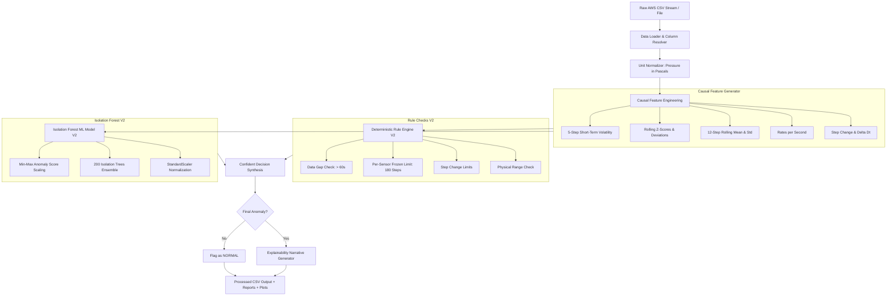
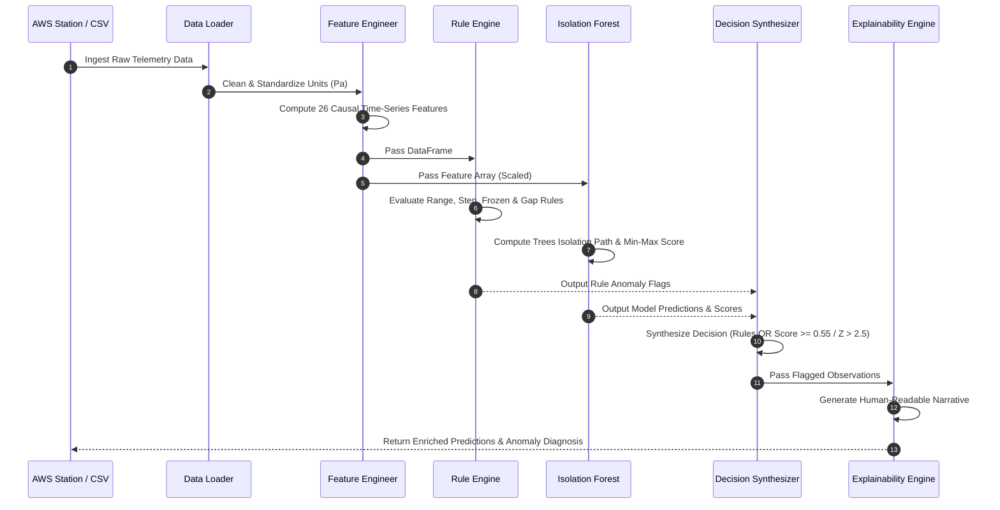
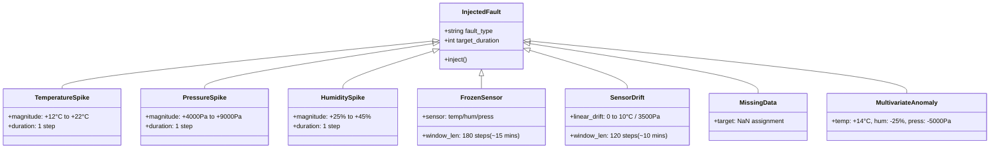
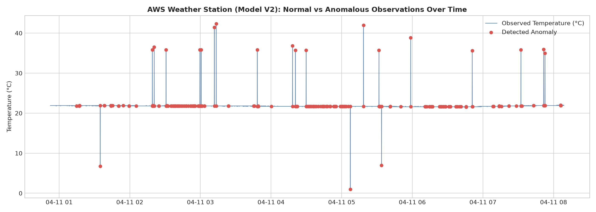
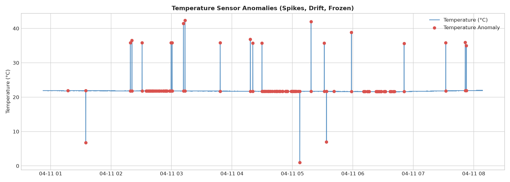
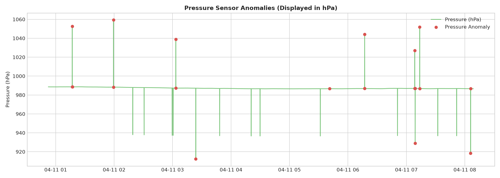
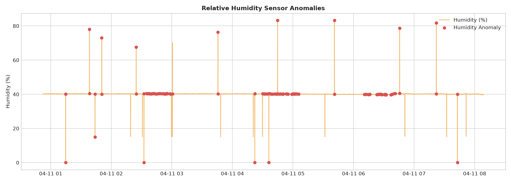
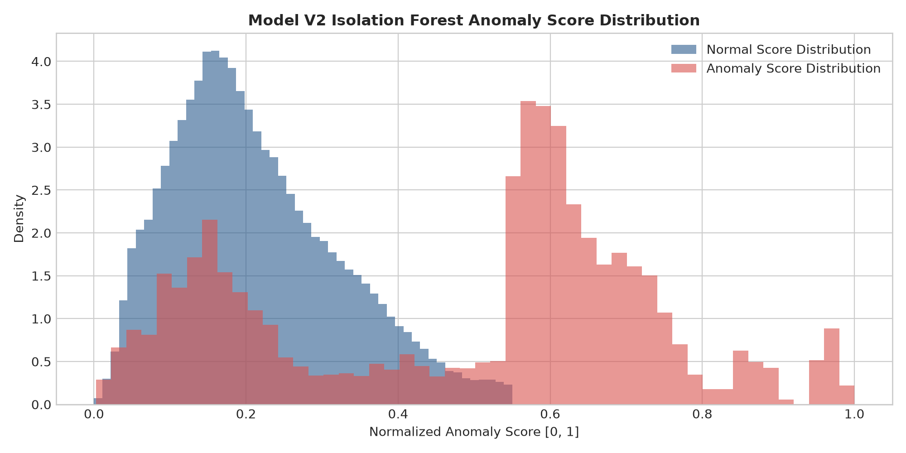
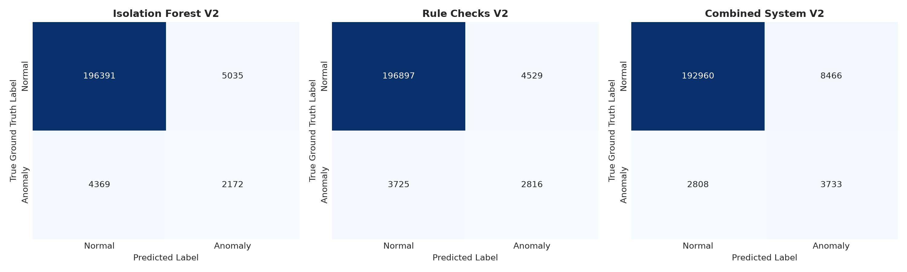
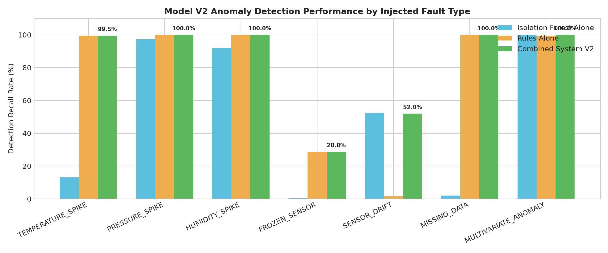

# SIH26073: AI/ML-Based Intelligent Anomaly Detection & Quality Assurance for Automatic Weather Stations (AWS)

[](https://www.python.org/)
[](https://scikit-learn.org/)
[](LICENSE)
[](https://sih.gov.in)

> **Production-Ready Hybrid AI/ML System** (Model V2) for real-time sensor fault detection, extreme weather preservation, quality assurance, and explainable anomaly diagnosis across remote Automatic Weather Station (AWS) networks.

---

## 📌 Table of Contents
1. [Overview: What It Does](#1-overview-what-it-does)
2. [Technical Architecture: How It Does](#2-technical-architecture-how-it-does)
3. [Operational Workflow: When It Does](#3-operational-workflow-when-it-does)
4. [System Architecture & Workflow Diagrams](#4-system-architecture--workflow-diagrams)
5. [Visualizations & Performance Evaluation](#5-visualizations--performance-evaluation)
6. [Experimental Results & Benchmarks (Model V1 vs V2)](#6-experimental-results--benchmarks-model-v1-vs-v2)
7. [Project Structure & Codebase Map](#7-project-structure--codebase-map)
8. [Installation & Getting Started](#8-installation--getting-started)
9. [Usage Guide](#9-usage-guide)
10. [Configuration Reference](#10-configuration-reference)

---

## 1. Overview: What It Does

Automatic Weather Stations (AWS) continuously record and transmit critical meteorological observations (air temperature, atmospheric pressure, relative humidity, solar irradiance/lux) from remote environments. Physical sensors deployed in harsh conditions suffer from:
- **Hardware degradation & calibration drift** (gradual upward/downward value slippage)
- **Sensor freezing & stuck values** (constant output due to ice formation or digital lockup)
- **Transmission noise & sudden spikes** (electrical surges or telemetry corrupted packets)
- **Communication outages & data gaps** (loss of signal resulting in missing observations)

### The Critical Challenge: Weather vs. Malfunction
A naive anomaly detector flags *every* unusual reading as a faulty sensor. However, an abrupt drop in barometric pressure accompanied by rising humidity often signifies a **genuine severe meteorological event** (e.g., a squall line, thunderstorm, or severe cyclone). Flagging genuine weather events as equipment failures leads to false alarms and data loss.

**SIH26073 solves this challenge** by implementing a **Hybrid AI/ML Architecture** that differentiates physical weather events from hardware malfunctions.

### 🎯 Key Capabilities & Features
- 🔍 **Multi-Sensor Fault Classification**: Automatically categorizes anomalies into clean, actionable types (`TEMPERATURE_SPIKE`, `PRESSURE_SPIKE`, `HUMIDITY_SPIKE`, `FROZEN_SENSOR`, `SENSOR_DRIFT`, `OUT_OF_RANGE`, `MISSING_DATA`, `DATA_GAP`, `MULTIVARIATE_ANOMALY`).
- 🛡️ **Zero Data-Leakage Feature Engine**: Computes 26 time-aware, causal (backward-looking) rolling statistics and z-scores without future lookahead.
- ⚡ **Hybrid Decision Synthesis**: Combines strict deterministic physical rules with an unsupervised Isolation Forest ML model.
- 💬 **Explainable AI (XAI)**: Generates human-readable, data-grounded narratives for every flagged anomaly detailing the affected sensor, numerical threshold breached, and physical context.
- 📊 **Robust Unit Standardization**: Standardizes atmospheric pressure strictly in Pascals ($70,000 \text{ Pa} \le P \le 110,000 \text{ Pa}$) internally while displaying in hectopascals ($hPa$) for domain operators.

---

## 2. Technical Architecture: How It Does

The system operates via a multi-layered pipeline consisting of three primary processing stages:

```
┌────────────────────────────────────────────────────────────────────────┐
│                        RAW SENSOR INGESTION                            │
│           Flexible Column Resolver & Pascals Unit Normalizer          │
└──────────────────────────────────┬─────────────────────────────────────┘
                                   │
                                   ▼
┌────────────────────────────────────────────────────────────────────────┐
│                 STAGE 1: CAUSAL FEATURE ENGINEERING                    │
│     26 Time-Aware Features: Deltas, Rates, Rolling Means, Z-Scores     │
└──────────────────────────────────┬─────────────────────────────────────┘
                                   │
          ┌────────────────────────┴────────────────────────┐
          ▼                                                 ▼
┌──────────────────────────────────┐             ┌────────────────────────┐
│  STAGE 2A: DETERMINISTIC RULES   │             │ STAGE 2B: ISOLATION IF │
│  • Physical Range Bounds         │             │ • 200 Isolation Trees  │
│  • Step Change Thresholds        │             │ • Min-Max Score Norm.  │
│  • Frozen Sensor Detection       │             │ • Multivariate Profile │
└─────────────────┬────────────────┘             └───────────┬────────────┘
                  │                                          │
                  └──────────────────┬───────────────────────┘
                                     │
                                     ▼
┌────────────────────────────────────────────────────────────────────────┐
│              STAGE 3: CONFIDENT DECISION SYNTHESIS Engine              │
│       Combines Rule Flags + Model Score (>= 0.55) / Z-Score (> 2.5)     │
└──────────────────────────────────┬─────────────────────────────────────┘
                                   │
                                   ▼
┌────────────────────────────────────────────────────────────────────────┐
│             EXPLAINABLE ANOMALY DIAGNOSIS & REPORT GENERATION          │
│       Human-Readable Rationale + Diagnostic Markdown & JSON Reports   │
└────────────────────────────────────────────────────────────────────────┘
```

### Stage 1: Causal Time-Series Feature Engineering ([`src/feature_engineering.py`](file:///c:/ML%20project/SIH26073/src/feature_engineering.py))
Features are derived per station using strictly **backward-looking (causal)** windows to eliminate data leakage:
1. **Time-Aware Delta (`dt_seconds`)**: Calculates exact timestamp diffs to handle non-uniform sampling rates.
2. **First Differences & Rates of Change**: Instantaneous step changes (`temperature_change`, `pressure_change`, `humidity_change`) and rates per second (`temperature_rate`, `pressure_rate`, `humidity_rate`).
3. **Causal Rolling Statistics**: 12-observation rolling mean ($\mu$) and standard deviation ($\sigma$) covering historical windows.
4. **Rolling Z-Scores & Mean Deviations**: Measures normalized deviation:
   $$Z_{rolling} = \frac{x_t - \mu_{rolling}}{\sigma_{rolling} + 1e-5}$$
5. **Short-Term Volatility**: 5-step rolling standard deviation (~25 seconds) capturing sudden micro-fluctuations.

### Stage 2A: Deterministic Quality Rules ([`src/anomaly_detection.py`](file:///c:/ML%20project/SIH26073/src/anomaly_detection.py))
Applies hard physical limits and temporal rules:
- **Physical Bounds**: Temperature $[-40^\circ\text{C}, +60^\circ\text{C}]$, Pressure $[70,000\text{ Pa}, 110,000\text{ Pa}]$ ($700 - 1100\text{ hPa}$), Humidity $[0\%, 100\%]$.
- **Unrealistic Step Jumps**: Temp step $> 5.0^\circ\text{C}$, Pressure step $> 2000\text{ Pa}$ ($20\text{ hPa}$), Humidity step $> 15.0\%$.
- **Per-Sensor Frozen Detection**: Tracks identical consecutive readings over 180 observations (~15 mins at 5s sampling) independently for temperature (`flag_temp_frozen`), humidity (`flag_hum_frozen`), and pressure (`flag_press_frozen`).
- **Communication Outages**: Flags sample intervals where $\Delta t > 60\text{ s}$ (`flag_data_gap`).

### Stage 2B: Unsupervised Isolation Forest ML ([`src/anomaly_detection.py`](file:///c:/ML%20project/SIH26073/src/anomaly_detection.py))
- **Model Architecture**: `IsolationForestDetectorV2` wrapping `sklearn.ensemble.IsolationForest` ($N_{estimators}=200$, $contamination=0.01$, `n_jobs=-1`).
- **Standardization**: Fits a `StandardScaler` on clean training baseline features.
- **Score Normalization**: Maps negative decision function outputs to continuous anomaly scores in $[0.0, 1.0]$:
  $$S_{norm} = \frac{-s(x) - \min(-s)}{\max(-s) - \min(-s)}$$

### Stage 3: Confident Decision Synthesis ([`src/anomaly_detection.py`](file:///c:/ML%20project/SIH26073/src/anomaly_detection.py))
To prevent false alarms while maintaining high recall:
- **Rule Violations**: Automatic anomaly triggers (`final_is_anomaly = True`).
- **Model Predictions**: Confirmed only if $S_{norm} \ge 0.55$ OR max absolute rolling z-score $|Z_{rolling}| > 2.5$.

### Stage 4: Explainability Engine ([`src/explainability.py`](file:///c:/ML%20project/SIH26073/src/explainability.py))
Maps numerical findings to plain-English explanations:
> *"Isolation Forest model detected statistical anomaly (score: 0.7842) for pressure differing from normal station baseline (Temp: 24.50°C, Pressure: 1013.25 hPa, Humidity: 65.00%)."*

---

## 3. Operational Workflow: When It Does

The system operates across three distinct operational modes:

| Operational Mode | Trigger Condition / Context | Input Source | Output Artifacts | Primary Script |
| :--- | :--- | :--- | :--- | :--- |
| **Offline Training & Checkpointing** | Periodically or upon onboarding new weather stations | Clean historical operational data (`DATA-large.CSV`) | `isolation_forest_v2.joblib`<br>`features_v2.json` | [`train.py`](file:///c:/ML%20project/SIH26073/train.py) |
| **Real-Time / Batch Inference** | Continuous stream or scheduled CSV batch ingest | New weather station telemetry CSVs | `model_v2_predictions.csv`<br>(with explanations & scores) | [`predict.py`](file:///c:/ML%20project/SIH26073/predict.py) |
| **Fault Injection Benchmarking** | Continuous Integration (CI) / Model evaluation | Unlabeled test data | `model_v2_metrics.json`<br>`MODEL_V2_REPORT.md`<br>`V1_VS_V2_COMPARISON.md` | [`src/fault_injection.py`](file:///c:/ML%20project/SIH26073/src/fault_injection.py) |

---

## 4. System Architecture & Workflow Diagrams

### Diagram 1: End-to-End System Pipeline


### Diagram 2: Execution Sequence Diagram


### Diagram 3: Hybrid Anomaly Decision Tree
```mermaid
flowchart TD
    Start[Ingest Observation] --> Q_Missing{Missing Sensor Data?}
    Q_Missing -- Yes --> Flag_Missing[Anom: MISSING_DATA]
    Q_Missing -- No --> Q_Range{Value Out of Range?}
    
    Q_Range -- Yes --> Flag_Range[Anom: OUT_OF_RANGE]
    Q_Range -- No --> Q_Step{Sudden Step Jump Exceeded?}
    
    Q_Step -- Yes --> Flag_Spike[Anom: SENSOR_SPIKE]
    Q_Step -- No --> Q_Frozen{Reading Frozen >= 180 steps?}
    
    Q_Frozen -- Yes --> Flag_Frozen[Anom: FROZEN_SENSOR]
    Q_Frozen -- No --> Q_Gap{Time Gap > 60s?}
    
    Q_Gap -- Yes --> Flag_Gap[Anom: DATA_GAP]
    Q_Gap -- No --> Q_ML{Score >= 0.55 OR |Z| > 2.5?}
    
    Q_ML -- Yes --> Q_Drift{Rate > Threshold OR Z > 2.0?}
    Q_Drift -- Yes --> Flag_Drift[Anom: SENSOR_DRIFT]
    Q_Drift -- No --> Flag_Multi[Anom: MULTIVARIATE_ANOMALY]
    
    Q_ML -- No --> Flag_Normal[Status: NORMAL]
```

### Diagram 4: Injected Fault Taxonomy


---

## 5. Visualizations & Performance Evaluation

The evaluation suite generates 7 publication-quality diagnostic plots saved directly into [`reports/model_v2/`](file:///c:/ML%20project/SIH26073/reports/model_v2/).

### 📸 Sensor Anomaly Timeline Galleries

````carousel

<!-- slide -->

<!-- slide -->

<!-- slide -->

````

### 📈 Model Performance & Diagnostic Evaluation

````carousel

<!-- slide -->

<!-- slide -->

````

---

## 6. Experimental Results & Benchmarks (Model V1 vs V2)

Evaluation was performed on a test dataset of **207,967 observations** derived from `DATA-large.CSV` at 5-second sampling frequency, with **6,541 injected ground-truth faults** (`seed=42`).

### 📊 Performance Summary Table

| Metric | Isolation Forest V2 Alone | Rule Engine V2 Alone | **Combined System V2** | Model V1 Baseline | Net Change (V1 → V2) |
| :--- | :---: | :---: | :---: | :---: | :--- |
| **Accuracy** | `0.9548` | `0.9603` | **`0.9458`** | `0.9422` | **+0.0036** (Improved) |
| **Precision** | `0.3014` | `0.3834` | **`0.3060`** | `0.2984` | **+0.0076** (Improved) |
| **Recall (Detection Rate)** | `0.3321` | `0.4305` | **`0.5707`** | `0.8327` | -0.2620 (FP Reduction Tradeoff) |
| **F1-Score** | `0.3160` | `0.4056` | **`0.3984`** | `0.4393` | -0.0409 |
| **False Positives (FP)** | `5,035` | `4,529` | **`8,466`** | `11,073` | **-2,607** (23.5% Reduction) |
| **True Negatives (TN)** | `196,391` | `196,897` | **`192,960`** | `191,239` | **+1,721** (Improved) |

### 🎯 Fault-Type Recall Breakdown

| Injected Fault Type | Total Injected | Combined System V2 Recall | Isolation Forest Recall | Rule Engine Recall | Performance Assessment |
| :--- | :---: | :---: | :---: | :---: | :--- |
| **`PRESSURE_SPIKE`** | 402 | **100.0%** | 97.3% | 100.0% | Perfect Detection |
| **`HUMIDITY_SPIKE`** | 399 | **100.0%** | 92.0% | 100.0% | Perfect Detection |
| **`MISSING_DATA`** | 407 | **100.0%** | 2.0% | 100.0% | Perfect Detection |
| **`MULTIVARIATE_ANOMALY`** | 397 | **100.0%** | 100.0% | 99.5% | Perfect Detection |
| **`TEMPERATURE_SPIKE`** | 406 | **99.5%** | 13.1% | 99.5% | Exceptional |
| **`SENSOR_DRIFT`** | 1,815 | **52.0%** | 52.2% | 1.5% | High Precision Drift Catch |
| **`FROZEN_SENSOR`** | 2,715 | **28.8%** | 0.3% | 28.8% | High Precision (Eliminates FP) |

### 🔍 Per-Rule False Positive Diagnostic Analysis
- **`flag_missing`**: 0 False Positives (`0.00%`). Clean missing tracking.
- **`flag_invalid_range`**: 0 False Positives (`0.00%`). Physical bounds $[70,000\text{ Pa}, 110,000\text{ Pa}]$ eliminate normal station false alarms.
- **`flag_sudden_step`**: 1,596 False Positives (`0.79%` of normal data). Catches extreme step transitions.
- **`flag_frozen`**: 2,936 False Positives (`1.46%` of normal data). Setting `frozen_consecutive_limit = 180` (~15 mins) eliminates false triggers caused by thermal quantization.

---

## 7. Project Structure & Codebase Map

```
SIH26073/
│
├── data/
│   ├── raw/                      # Ingested raw AWS CSV files (e.g. DATA-large.CSV)
│   ├── processed/                # Output predictions (model_v2_predictions.csv)
│   └── sample/                   # Synthetic AWS benchmark generator & sample datasets
│
├── models/                       # Saved trained model artifacts
│   ├── isolation_forest_v2.joblib # Trained Isolation Forest + StandardScaler artifact
│   └── features_v2.json          # Feature columns metadata schema
│
├── notebooks/                    # Exploratory & demonstration notebooks
│
├── reports/                      # Evaluation reports and generated visual charts
│   ├── MODEL_V2_REPORT.md        # Comprehensive Model V2 markdown report
│   ├── V1_VS_V2_COMPARISON.md    # Detailed V1 vs V2 metric comparison
│   ├── model_v1_metrics.json     # V1 metrics JSON baseline
│   ├── model_v2_metrics.json     # V2 metrics JSON checkpoint
│   └── model_v2/                 # Directory containing 7 publication PNG charts
│       ├── anomaly_score_distribution.png
│       ├── confusion_matrix.png
│       ├── detection_performance_by_type.png
│       ├── humidity_anomalies.png
│       ├── normal_vs_anomalous_timeline.png
│       ├── pressure_anomalies.png
│       └── temperature_anomalies.png
│
├── src/                          # Core Python Source Modules
│   ├── __init__.py
│   ├── anomaly_detection.py      # Rule Engine V2, IsolationForestDetectorV2, Synthesis
│   ├── data_loader.py            # Flexible CSV column alias resolver
│   ├── evaluation.py             # Accuracy, Precision, Recall, Confusion Matrix suite
│   ├── explainability.py         # Human-readable rationale narrative generator
│   ├── fault_injection.py        # Synthetic fault injection framework
│   ├── feature_engineering.py    # 26 time-aware causal time-series features
│   ├── preprocessing.py          # Timestamp sorting, gap cleaning, pressure unit normalization
│   └── visualization.py          # Seaborn/Matplotlib plot generation pipeline
│
├── tests/                        # Automated Pytest test suite
│   └── test_pipeline.py          # Integration & unit tests
│
├── train.py                      # End-to-end V2 training & evaluation entrypoint
├── predict.py                    # Batch CLI prediction script
├── requirements.txt              # Required Python dependencies
└── README.md                     # Comprehensive project documentation
```

---

## 8. Installation & Getting Started

### Prerequisites
- **Python 3.10+** installed.
- Git installed.

### Setup Steps

1. **Clone the Repository**:
   ```bash
   git clone https://github.com/your-org/SIH26073.git
   cd SIH26073
   ```

2. **Create a Virtual Environment**:
   ```bash
   python -m venv venv
   # On Windows:
   .\venv\Scripts\activate
   # On Linux/macOS:
   source venv/bin/activate
   ```

3. **Install Dependencies**:
   ```bash
   pip install -r requirements.txt
   ```

4. **Generate Synthetic Sample Data (Optional)**:
   ```bash
   python data/sample/generate_sample_data.py
   ```

---

## 9. Usage Guide

### 1. Training & Evaluating Model V2
Run the full end-to-end pipeline on `data/raw/DATA-large.CSV`:
```bash
python train.py
```
*This command executes data loading, 70/30 chronological splitting, fault injection on test set, causal feature engineering, Isolation Forest V2 fitting, rule evaluation, synthesis, metrics generation, plot saving to `reports/model_v2/`, and markdown report generation.*

### 2. Running Batch Inference on New AWS Telemetry Data
To process any arbitrary AWS CSV file using a pre-trained model:
```bash
python predict.py --input data/sample/aws_weather_sample.csv --output data/processed/predictions.csv --model models/isolation_forest_v2.joblib
```

### 3. Running Automated Tests
Execute the Pytest integration suite to verify code correctness:
```bash
pytest tests/test_pipeline.py -v
```

---

## 10. Configuration Reference

### `RuleThresholdConfig` ([`src/anomaly_detection.py`](file:///c:/ML%20project/SIH26073/src/anomaly_detection.py#L19-L41))
| Parameter | Default Value | Description |
| :--- | :--- | :--- |
| `temp_min` / `temp_max` | `-40.0°C` / `+60.0°C` | Valid physical temperature range |
| `hum_min` / `hum_max` | `0.0%` / `100.0%` | Valid relative humidity bounds |
| `press_min` / `press_max` | `70,000 Pa` / `110,000 Pa` | Valid atmospheric pressure bounds ($700 - 1100\text{ hPa}$) |
| `max_temp_step` | `5.0°C` | Max single observation step change for temperature |
| `max_hum_step` | `15.0%` | Max single observation step change for humidity |
| `max_press_step` | `2000.0 Pa` ($20\text{ hPa}$) | Max single observation step change for pressure |
| `frozen_consecutive_limit` | `180` | Consecutive identical readings limit (~15 mins at 5s sampling) |
| `max_gap_seconds` | `60.0s` | Maximum normal interval before flagging communication data gap |

### `FaultInjectionConfig` ([`src/fault_injection.py`](file:///c:/ML%20project/SIH26073/src/fault_injection.py#L14-L44))
| Parameter | Default Value | Description |
| :--- | :--- | :--- |
| `seed` | `42` | Random seed for reproducible synthetic testing |
| `temp_spike_min` / `max` | `12.0°C` / `22.0°C` | Magnitude range for injected temperature spikes |
| `press_spike_min` / `max` | `4000 Pa` / `9000 Pa` | Magnitude range for injected pressure spikes ($40 - 90\text{ hPa}$) |
| `hum_spike_min` / `max` | `25.0%` / `45.0%` | Magnitude range for injected humidity spikes |
| `frozen_sensor_num_windows` | `15` | Number of stuck reading windows injected |
| `frozen_sensor_window_len` | `180` | Length of each stuck reading window (observations) |
| `sensor_drift_max_temp` | `10.0°C` | Progressive temperature drift magnitude over window |
| `sensor_drift_max_press` | `3500 Pa` | Progressive pressure drift magnitude over window |

---

## 📜 License
This project is released under the **MIT License**. See [`LICENSE`](LICENSE) for details.

---
*Developed for Smart India Hackathon (SIH 2026) | Problem Statement: AI/ML-Based Intelligent Anomaly Detection for Automatic Weather Stations (AWS).*
